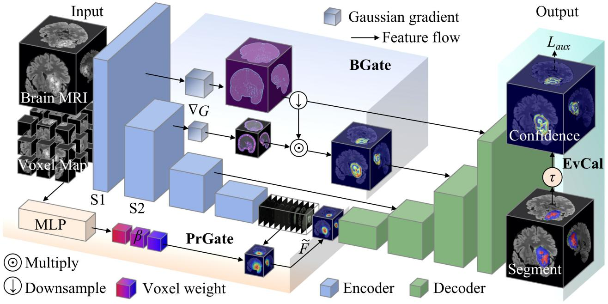

<p align="center">
  
</p>

<h1 align="center">Multi-Prior Knowledge Driving and Evidential Calibration for Trustworthy Brain Tumor Segmentation</h1>

<p align="center">
  <a href="https://www.python.org/downloads/"></a>
  <a href="https://pytorch.org/"></a>
  <a href="https://creativecommons.org/licenses/by-nc/4.0/"></a>
  <a href="https://monai.io/"></a>
</p>

<p align="center">
  <b>Knowledge-driven 3D brain tumor segmentation framework with boundary gating,
  feature-conditioned multi-scale gating, and fitted temperature-scaling evidential calibration.</b><br>
  <b>93.64%</b> Mean Dice and <b>5.19 mm</b> HD95 on BraTS 2021 with <b>30.0 M</b> parameters.
</p>

---

## Overview

**KnowNet** is a knowledge-driven 3D segmentation framework built on a SegResNet
backbone with three pluggable modules:

| Module | Code Name | Role |
|--------|-----------|------|
| **BGate** | `BoundGATE` | Multi-scale Gaussian-gradient boundary signal → sigmoid gating at the stage-2 skip; sharpens ET/ED interfaces without suppressing the tumour interior |
| **PrGate** | `PrGate` (legacy alias `PyraGATE`) | Coordinate logits **plus** a 1×1×1 feature logit branch → softmax-gated tri-dilation (d=1,2,3) depthwise Conv3d fusion at the bottleneck; the gate is conditioned on both anatomy and image evidence |
| **EvCal** | `EvCal` (legacy alias `EKDCalib`/`EKD_CALIB`) | Softplus evidence with a **fixed τ=1 during training**; the temperature is **fitted after training** on the validation split by minimizing the Brier score (τ\*=0.82 on BraTS 2021). The detached uncertainty weight `w_U = 1/(1+Ū)` scales the deep-supervision auxiliary losses |

Reference results (five runs, case-level 8:1:1 split, mean ± std):

- **93.64 ± 0.26%** Mean Dice on BraTS 2021, **92.85 ± 0.31%** on BraTS 2020, **92.15 ± 0.25%** on BraTS 2023
- **5.19 ± 0.14 mm** Mean HD95 on BraTS 2021 (WT 3.29 / TC 5.22 / ET 7.06)
- **+2.94%** Mean Dice over the strongest baseline (Swin UNETR, 90.70%), with
  **30.0 M** vs **62.1 M** parameters
- Calibration: **ECE 0.0100**, **ACE 0.0098**, **Brier 0.0527**, **AUROC 0.911** for error detection
- Cross-dataset transfer to BraTS 2020: **89.30 / 86.26 / 82.84%** Dice (WT/TC/ET), HD95 **7.50 mm**

---

## Installation

```bash
git clone <repository-url> KnowNet
cd KnowNet

# Git LFS is required for the sample cases under predict/
git lfs install
git lfs pull

pip install -r requirements.txt
```

**Requirements:** Python 3.10+, PyTorch 2.0+. A CUDA GPU is recommended for the full
200-epoch training, but the code is device-agnostic and also runs on Apple Silicon
(MPS) and CPU for inference, smoke runs and tests.

**Hardware notes.** Full training and full-volume 128³ sliding-window evaluation
were run on an RTX 4090. On memory-constrained machines (e.g. a 16 GB Apple Silicon
laptop) a 128³ forward pass of the 30 M-parameter model can exceed the available
memory; use a smaller `evaluation.window_size` / `--no-sliding-window`, or run the
`smoke` mode and the test suite, which use 32³–64³ volumes. The code selects
CUDA → MPS → CPU automatically.

| Package | Version | Purpose |
|---------|---------|---------|
| `torch` | ≥ 2.0.0 | Deep learning framework |
| `torchvision` | ≥ 0.15.0 | Supplementary utilities |
| `monai` | ≥ 1.2.0 | Medical image operations |
| `nibabel` | ≥ 5.0.0 | NIfTI I/O |
| `numpy` | ≥ 1.22.0 | Numerical operations |
| `scipy` | ≥ 1.8.0 | Distance transforms & calibration metrics |
| `pyyaml` | ≥ 6.0 | Config file parsing |
| `tqdm` | ≥ 4.64.0 | Progress bars |
| `matplotlib` | ≥ 3.6.0 | Visualization |
| `pytest` | ≥ 7.0.0 | Test suite |

Conda setup:

```bash
conda create -n knownet python=3.10 -y
conda activate knownet
pip install -r requirements.txt
```

---

## Dataset Preparation

### Supported datasets

Each case contains four MRI modalities (T1, T1ce, T2, FLAIR) and voxel-level annotations
of the three clinical sub-regions (WT = 1+2+3, TC = 1+3, ET = 3; label 4 is remapped to 3
internally). BraTS 2021 and BraTS 2023 share the same case cohort, so one partition is
applied to both versions and only the annotation version differs.

| Dataset | Total | Training | Validation | Test | Source |
|---------|:-----:|:--------:|:----------:|:----:|--------|
| **BraTS 2021** | 1,251 | 1,000 | 125 | 126 | [Kaggle](https://www.kaggle.com/datasets/syedsajid/brats2021) |
| **BraTS 2020** | 369 | 295 | 37 | 37 | [Kaggle](https://www.kaggle.com/datasets/awsaf49/brats20-dataset-training-validation) |
| **BraTS 2023** | 1,251 | 1,000 | 125 | 126 | [Kaggle](https://www.kaggle.com/datasets/nicozoro56/brats2023) |

Dataset download links used for this project are collected in
[`data/README.md`](data/README.md).

### Data structure

```
data/BraTS2021/
├── BraTS2021_00000/
│   ├── BraTS2021_00000_flair.nii.gz
│   ├── BraTS2021_00000_t1.nii.gz
│   ├── BraTS2021_00000_t1ce.nii.gz
│   ├── BraTS2021_00000_t2.nii.gz
│   └── BraTS2021_00000_seg.nii.gz
├── BraTS2021_00001/
└── ...
```

`data_root` is set in `configs/config.yaml`. The split is generated deterministically
from the case list (`data.split_seed`), so the train/validation/test partitions are
shared by all runs and all ablations.

---

## Usage

All modes are dispatched through `run.py`:

```bash
python run.py --mode {train,test,eval,ablation,gating,calibrate,smoke} \
              [--config configs/config.yaml] [--device auto]
```

| Argument | Default | Description |
|----------|---------|-------------|
| `--mode` | `train` | `train`, `test`, `eval`, `ablation`, `gating`, `calibrate`, `smoke` |
| `--config` | `configs/config.yaml` | Path to the YAML configuration |
| `--device` | from config (`auto`) | `auto`, `cpu`, `mps`, `cuda`, `cuda:0` |
| `--epochs` | from config | Override the number of training epochs |
| `--round` | from config | Iteration-round label recorded by the experiment recorder |
| `--checkpoint` | `weights/best_checkpoint.pth` | Checkpoint for evaluation/ablation |
| `--checkpoint-dir` | `weights` | Directory for saved checkpoints |
| `--num_seeds` | 1 | Repeat training/gating runs with seeds `seed+i` |

`--device auto` resolves to CUDA → MPS → CPU, so the same commands work on a GPU
server and on a laptop.

### Full training

```bash
python run.py --mode train --config configs/config.yaml
```

Training configuration (`configs/config.yaml`):

- **Epochs:** 200 | **Batch size:** 2 | **Optimizer:** AdamW (lr=5e-4, wd=1e-4)
- **Scheduler:** Poly LR (power=0.9) with 5-epoch linear warmup
- **Gradient accumulation:** 4 steps; dual gradient clipping (clip=0.5)
- **Loss:** deep-supervision Dice (main=1.0, aux=[0.4, 0.3, 0.2, 0.1]) with
  uncertainty-derived auxiliary weight `w_U = 1/(1+Ū)` (`loss.aux_weight_mode:
  uncertainty`); `constant` (0.75) and `none` reproduce the ablation controls
- **Normalization:** GroupNorm (not BatchNorm); activation LeakyReLU(0.01)
- **Early stop:** patience 30, validation every 10 epochs
- **Checkpoints:** `weights/best_checkpoint.pth` (best validation Dice) and
  `weights/latest_checkpoint.pth`; both are gitignored

After training the script evaluates the held-out test split
(`test_results.json`, including per-case metrics) and fits the EvCal temperature on
the validation split (`weights/best_checkpoint_calibrated.pth`, `calibration.json`).

### Evaluation

```bash
# Held-out test split (default: weights/best_checkpoint.pth)
python run.py --mode test --config configs/config.yaml

# Validation split (model selection / calibration)
python run.py --mode eval --config configs/config.yaml
```

Outputs Dice, IoU and HD95 for WT, TC and ET, aggregated over the whole volume with
sliding-window inference (window 128³, stride 64³) and written to
`test_results.json` / `val_results.json`.

### Post-hoc calibration (EvCal)

```bash
python run.py --mode calibrate --config configs/config.yaml
```

Collects tumour-voxel logits on the validation split, fits τ over a 500-point
logarithmic grid in `[0.05, 5.00]` by minimizing the Brier score, stores
τ in the EvCal buffer of `weights/best_checkpoint_calibrated.pth` and writes
`calibration.json`. Because τ only rescales the evidence, the argmax and therefore
all segmentation metrics are unchanged.

### Module ablation

```bash
# Disable each module in turn and fine-tune for 30 epochs
python run.py --mode ablation --config configs/config.yaml

# Five seeds for the statistical analysis
python run.py --mode ablation --config configs/config.yaml --num_seeds 5
```

Per-module ΔDice and the run summary are recorded in `ablation_results.json` and
`experiment_summary.json`.

### Gating-design ablation

```bash
# uniform / global / coordinate-only / feature-only / coordinate+feature
python run.py --mode gating --config configs/config.yaml
```

Each variant is trained with the same recipe and the gate parameter count is
recorded in `gating_results.json`.

### Batch inference & visualization

```bash
python predict/predict.py \
  --input-dir predict \
  --output-dir predict/results \
  --checkpoint weights/best_checkpoint_calibrated.pth
```

For every `BraTS2021_*` case in `--input-dir` the script performs per-scan,
per-channel z-score normalization, whole-volume sliding-window inference and writes:

- `{case}_pred.nii.gz`: int16 segmentation volume
- `{case}_modalities.png`: the four input modalities
- `{case}_overlay.png`: GT / prediction contours over FLAIR
- `{case}_uncertainty.png`: EvCal uncertainty map
- `samples_info.json`: per-case Dice (WT/TC/ET), HD95 and mean uncertainty

Pass `--no-sliding-window` for a faster centre-crop inference, or change
`evaluation.window_size` / `evaluation.stride` in the config. The sample NIfTI
files bundled under `predict/` are tracked with Git LFS (`git lfs pull`); the
script skips any file that is still an LFS pointer.

### Self-check without data or weights

```bash
python run.py --mode smoke --device cpu
```

Runs a synthetic forward/backward pass (32³), all five PrGate gating variants,
sliding-window inference (64³) and the τ fit, and prints the parameter count. Useful
for CI and for verifying a fresh installation on any device.

### Test suite

```bash
python -m pytest tests -q
```

The suite covers the model (~30.0 M parameters and the gate parameter counts), the
EvCal softplus evidence / uncertainty / τ fit, the detached `w_U` loss, sliding-window
inference, calibration metrics (ECE/ACE/Brier/NLL/AUROC), the 8:1:1 split, and an
end-to-end pipeline on a tiny synthetic BraTS-format dataset (training, evaluation,
calibration and `predict/predict.py`). It runs on CPU in about a minute.

---

## Evaluation protocol

- **Split:** case-level 8:1:1 (train/validation/test), fixed seed, shared by every
  method, every ablation and every run. The validation split selects the checkpoint
  and the PrGate MLP width and fits the calibration temperature; the test split is
  used only for the final assessment.
- **Pre-processing:** each sequence is z-score normalized per scan and per channel;
  no statistic is shared across cases. No additional skull stripping or resampling is
  applied (the official BraTS pre-processing is used as provided).
- **Training crops:** 128³ crops centred on a randomly chosen tumour voxel.
- **Inference:** a sliding window over the complete volume, so Dice and HD95 cover the
  whole tumour.
- **Statistics:** five runs share one split and differ only in the seed. Paired
  two-sided Wilcoxon signed-rank tests over the 126 BraTS 2021 test cases with
  Bonferroni correction over the 12 comparisons; Cliff's delta is reported as the
  effect size. Per-case metrics are stored in `*_results.json` so the tests can be
  reproduced without re-running inference.

---

## Results

Reference results (mean ± standard deviation over five runs on the held-out test
splits).

### Dice coefficients (%) on three BraTS datasets

| Method | BraTS 2021 WT | TC | ET | Mean | BraTS 2020 Mean | BraTS 2023 Mean |
|--------|:---:|:---:|:---:|:---:|:---:|:---:|
| MBANet | 92.31 | 88.55 | 85.72 | 88.86 ± 0.82 | 88.07 | 87.38 |
| 3DUV-NetR+ | 92.01 | 88.13 | 85.35 | 88.50 ± 0.83 | 87.81 | 87.13 |
| VcaNet | 92.48 | 88.88 | 85.96 | 89.11 ± 0.75 | 88.39 | 87.66 |
| SegResNet | 92.93 | 89.45 | 86.30 | 89.56 ± 0.65 | 88.80 | 88.08 |
| nnU-Net | 92.77 | 89.75 | 87.65 | 90.06 ± 0.54 | 89.25 | 88.59 |
| Swin UNETR | 93.11 | 90.39 | 88.60 | 90.70 ± 0.50 | 89.87 | 89.19 |
| **KnowNet** | **95.86** | **93.56** | **91.50** | **93.64 ± 0.26** | **92.85 ± 0.31** | **92.15 ± 0.25** |

KnowNet is best in every sub-region on every dataset. All six paired comparisons are
significant on both Dice and HD95 after Bonferroni correction (all p < 4.7 × 10⁻⁷,
Cliff's delta > 0.474). Full BraTS 2020/2023 sub-region values: 95.53/92.75/90.27 and
95.04/92.16/89.25 (WT/TC/ET).

### HD95 (mm) on three BraTS datasets

| Method | BraTS 2021 WT | TC | ET | Mean | BraTS 2020 Mean | BraTS 2023 Mean |
|--------|:---:|:---:|:---:|:---:|:---:|:---:|
| MBANet | 4.21 | 6.59 | 8.93 | 6.58 ± 0.35 | 6.96 | 7.38 |
| 3DUV-NetR+ | 4.30 | 6.65 | 9.03 | 6.66 ± 0.37 | 7.05 | 7.40 |
| VcaNet | 4.15 | 6.52 | 8.87 | 6.51 ± 0.30 | 6.88 | 7.27 |
| SegResNet | 4.04 | 6.48 | 8.74 | 6.42 ± 0.30 | 6.81 | 7.24 |
| nnU-Net | 3.87 | 6.20 | 8.34 | 6.14 ± 0.24 | 6.60 | 7.04 |
| Swin UNETR | 3.82 | 5.97 | 8.10 | 5.96 ± 0.22 | 6.48 | 6.91 |
| **KnowNet** | **3.29** | **5.22** | **7.06** | **5.19 ± 0.14** | **5.65 ± 0.18** | **6.03 ± 0.18** |


### Cross-dataset transfer

| Method | 2021→2020 Dice WT / TC / ET | HD95 | 2020→2021 Dice WT / TC / ET | HD95 |
|--------|:---------------------------:|:----:|:---------------------------:|:----:|
| SegResNet | 84.71 / 81.41 / 76.98 | 9.41 | 83.01 / 79.94 / 75.32 | 9.85 |
| DoFE | 85.52 / 82.30 / 78.10 | 8.94 | 84.02 / 80.76 / 76.49 | 9.39 |
| FedDG | 85.78 / 82.62 / 78.53 | 8.87 | 84.24 / 81.12 / 76.87 | 9.26 |
| DCAC | 86.69 / 83.50 / 79.61 | 8.47 | 85.31 / 82.07 / 78.00 | 8.89 |
| WT-PSE | 87.07 / 83.88 / 80.09 | 8.28 | 85.49 / 82.46 / 78.45 | 8.60 |
| Mamba-Sea | 87.38 / 84.08 / 80.59 | 8.21 | 85.68 / 82.73 / 78.84 | 8.54 |
| De-LightSAM | 86.93 / 83.76 / 79.96 | 8.31 | 85.34 / 82.33 / 78.32 | 8.75 |
| **KnowNet** | **89.30 / 86.26 / 82.84** | **7.50** | **87.77 / 84.89 / 81.45** | **7.91** |


### Efficiency (128³ input, RTX 4090)

| Method | Params (M) | Inference (ms/window) | GFLOPs |
|--------|:----------:|:---------------------:|:------:|
| MBANet | 28.5 | 335 | 1163 |
| 3DUV-NetR+ | 33.2 | 425 | 1407 |
| VcaNet | 35.1 | 405 | 1325 |
| SegResNet | 29.7 | 310 | 1191 |
| nnU-Net | 31.2 | 355 | 1243 |
| Swin UNETR | 62.1 | 525 | 1773 |
| **KnowNet** | **30.0** | **345** | **1553** |

KnowNet adds only 0.3 M parameters over SegResNet (+1.01%); BGate accounts for 361.6
of the 362 GFLOPs increase. The PrGate gating subnetwork itself has just 1.078 K
parameters.

---

## Hyperparameters

| System component | Specification |
|------------------|---------------|
| GPU | NVIDIA RTX 4090 × 1 (reference environment) |
| OS | Ubuntu 20.04 LTS |
| CUDA | 11.8 |
| Framework | PyTorch 2.0 |
| Input size | 128 × 128 × 128 |

| Training parameter | Value |
|--------------------|-------|
| Optimizer | AdamW |
| Learning rate | 5 × 10⁻⁴ |
| Weight decay | 1 × 10⁻⁴ |
| Batch size | 2 |
| Epochs | 200 |
| Scheduler | Poly (power = 0.9) |
| Warmup epochs | 5 |
| Gradient accumulation | 4 steps |
| Gradient clip | 0.5 |
| Early stop patience | 30 |

| Module | Parameter | Value |
|--------|-----------|-------|
| BGate | Gradient sigma | [1.0, 2.0] |
| PrGate | Dilation rates | [1, 2, 3] |
| PrGate | MLP hidden dim `H_mlp` | 16 |
| PrGate | Coordinate normalization | [0, 1] |
| EvCal | Training temperature | fixed at 1.0 |
| EvCal | Fitted temperature τ\* | 0.82 (validation Brier) |
| EvCal | τ grid | 500 points, log-uniform [0.05, 5.00] |

---

## Project structure

```
KnowNet/
├── run.py                     # Entry point: train / test / eval / ablation / gating / calibrate / smoke
├── requirements.txt           # Python dependencies
├── configs/
│   └── config.yaml            # All hyperparameters (data, model, training, loss, evaluation, calibration)
├── data/
│   ├── README.md              # Dataset download links and layout
│   ├── dataset.py             # BraTSDataset: NIfTI loading, 8:1:1 split, tumour-centred crops, label remap
│   ├── transforms.py          # Augmentation (scale, gamma, noise, contrast, flip, per-channel z-score)
│   └── fig1.png               # Architecture diagram
├── models/
│   ├── __init__.py            # BrainTumorSegModel: backbone + 3 modules; build_model()
│   ├── backbone.py            # 5-stage ResBlock3D encoder, decoder with deep supervision
│   └── innovation_module.py   # BoundGATE, PrGate (5 gating variants), EvCal
├── engines/
│   ├── trainer.py             # Training loop, poly LR + warmup, accumulation, dual clipping, early stop
│   └── evaluator.py           # Whole-volume evaluation: Dice, IoU, HD95 per region
├── losses/
│   ├── __init__.py
│   └── loss.py                # DiceLoss, DeepSupervisionLoss (detached uncertainty weight w_U)
├── utils/
│   ├── calibration.py         # ECE / ACE / Brier / NLL / AUROC, τ grid search
│   ├── checkpoint.py          # Checkpoint loading with legacy key remapping
│   ├── device.py              # Device resolution: cuda → mps → cpu
│   ├── inference.py           # Sliding-window inference and centre crop
│   ├── metrics.py             # DiceScore, IoUScore, HD95Score, region_dice
│   ├── temperature.py         # Validation-split Brier fit of τ, calibrated checkpoint
│   ├── logger.py              # Logging to file + stdout
│   ├── reproducibility.py     # Seed setting
│   └── experiment_recorder.py # Ablation / SOTA tracking
├── predict/
│   ├── predict.py             # Batch inference, uncertainty maps, PNG overlays
│   └── BraTS2021_*/           # Sample test cases (Git LFS)
├── tests/                     # pytest suite (model, EvCal, losses, inference, calibration, dataset, pipeline)
└── weights/                   # Checkpoints (auto-created, gitignored)
```

---

## License

This project is licensed under **Creative Commons Attribution-NonCommercial 4.0
International (CC BY-NC 4.0)**. The BraTS data are subject to their own terms of use.
